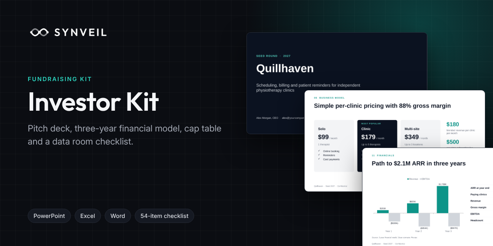
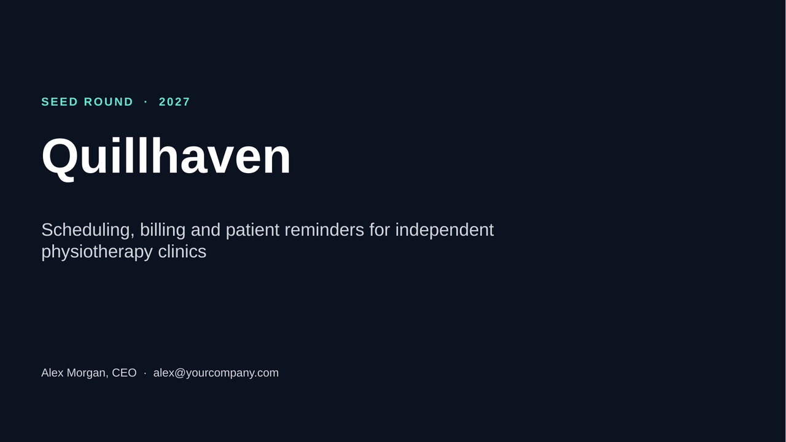
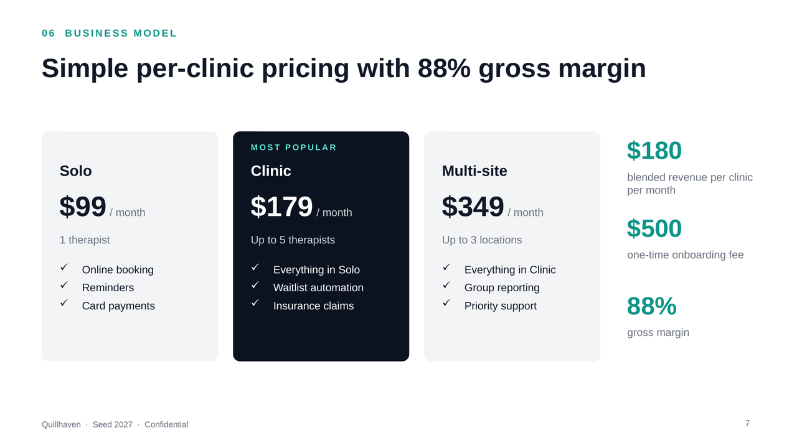
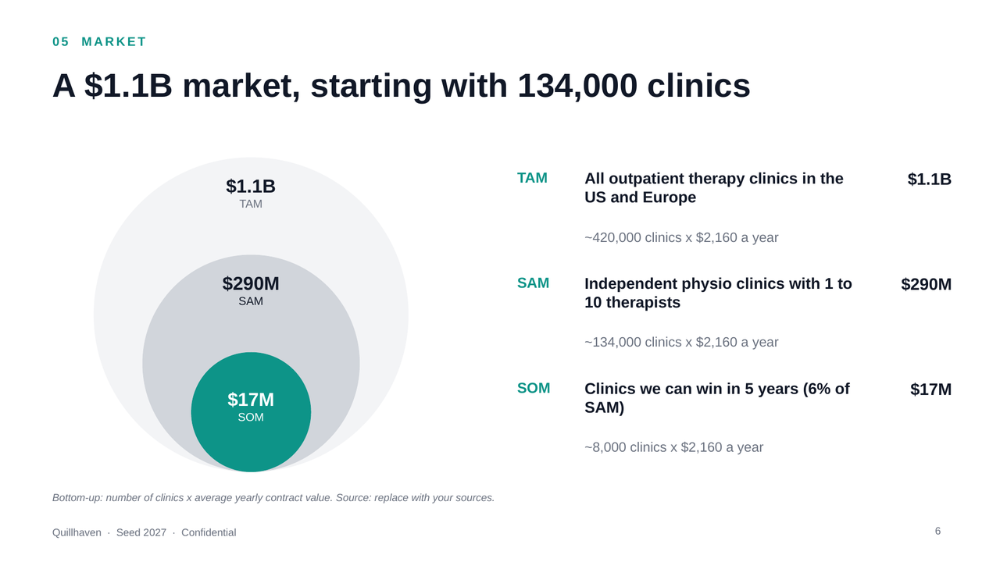
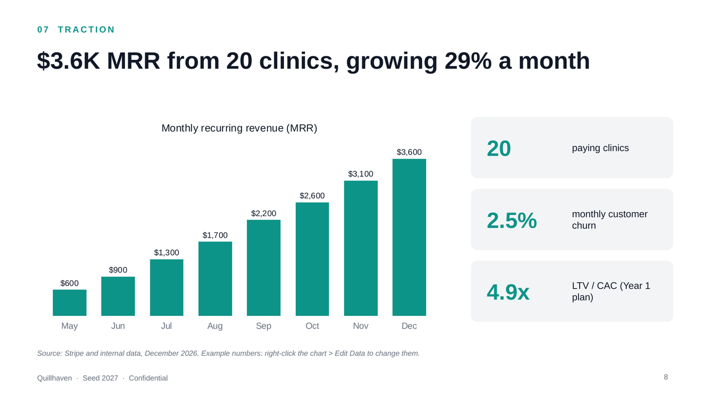
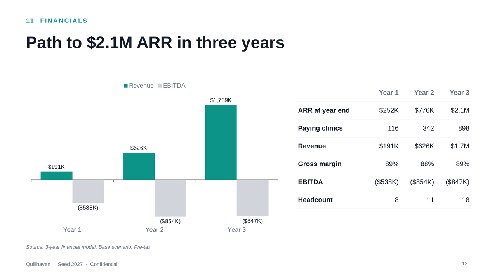
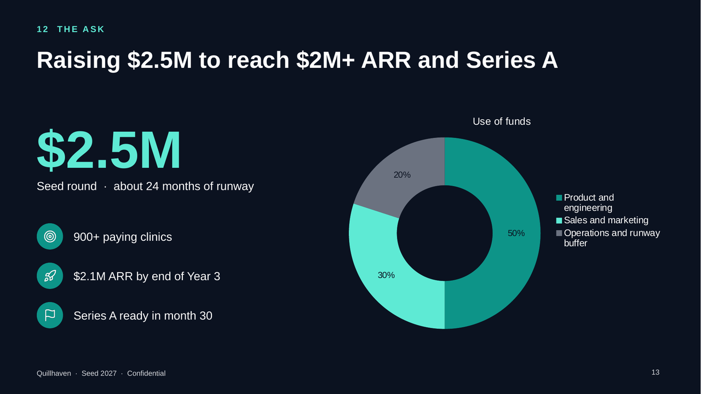

# Investor Kit

**Pitch deck, financial model, cap table and data room checklist.** Everything a seed round asks for, in files you already know how to use.

**$199, one-time** · [**Buy on Whop →**](https://whop.com/synveil/investor-kit-f0/) · [All Synveil kits](https://synveil.whop.site/)

> This repo is the public page for the Investor Kit. The files are delivered as a download when you buy. They aren't in this repo.

## What's inside

| File | What it is |
|---|---|
| **Pitch deck** (.pptx) | 15 slides with speaker notes on every slide. Works in PowerPoint, Keynote and Google Slides |
| **Financial model** (.xlsx) | Monthly three-year SaaS model: assumptions, headcount, revenue, P&L, cash flow, runway, unit economics and charts. Inputs are in blue |
| **Cap table** (.xlsx) | Today's cap table, SAFE conversion and a priced-round modeller with built-in checks |
| **Data room checklist** (.xlsx) | 54 documents investors ask for, Seed to Series A, with a progress tracker |
| **Investor update** (.docx) | A monthly update template plus a filled-in example |
| **Guide** (PDF) | How to use each file, in the order that saves the most time |

## Screenshots

Slides from the pitch deck template. The company in the example is made up, so you can see how a finished deck reads before you put your own numbers in.

| Cover | Business model |
|---|---|
|  |  |
| **Market** | **Traction** |
|  |  |
| **Financials** | **The ask** |
|  |  |

## How you get it

1. Buy on [Whop](https://whop.com/synveil/investor-kit-f0/). Access is instant.
2. Download the zip and start with the guide.
3. Build the financial model first, then the cap table, then the deck. Your numbers drive the story.

Also in [Synveil Complete](https://whop.com/synveil/synveil-complete/), the bundle of all five Synveil kits.
